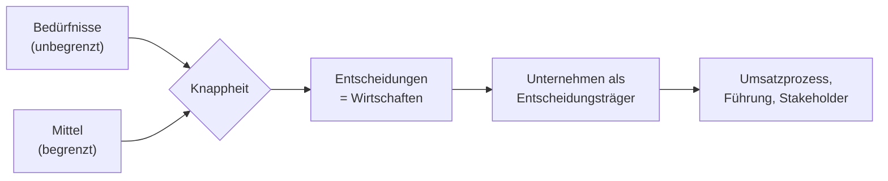
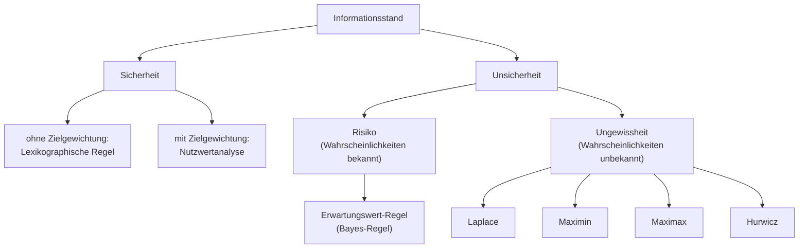
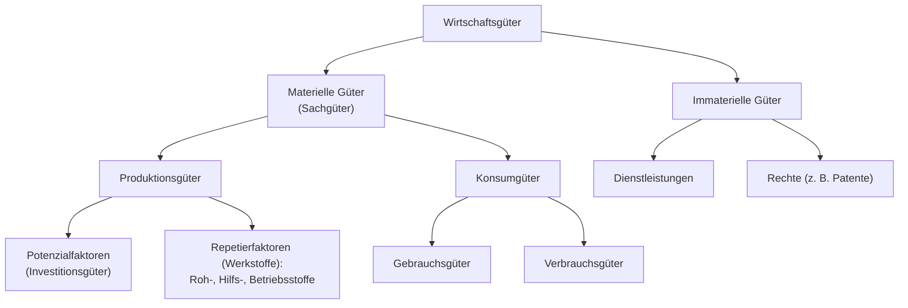
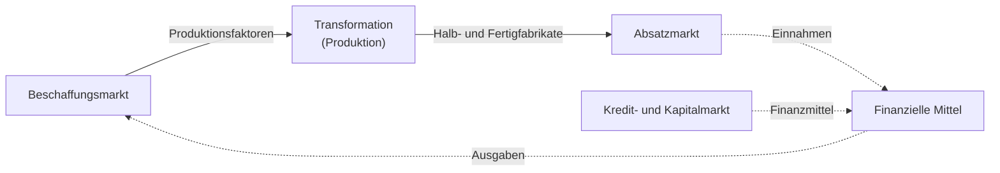

## Überblick

Menschen haben **unbegrenzte Bedürfnisse**, aber nur **knappe Mittel**. Deshalb muss ständig entschieden werden: Welche Bedürfnisse befriedige ich, und mit welchen Mitteln? Genau dieses Entscheiden unter Knappheit heißt **Wirtschaften**. Die BWL betrachtet diese Entscheidungen aus Sicht von **Unternehmen**.

Der rote Faden des Kapitels:

> [!KLAUSUR]
> Dieses Kapitel ist **definitionslastig**: Bedürfnis/Bedarf, Maslow, Entscheidungsregeln, Wirtschaftsgüter, ökonomisches Prinzip, Effizienz vs. Effektivität, Transaktionskosten, Stakeholder. Lerne die Definitionen wörtlich mit den Karteikarten.

## Bedürfnis, Motiv, Bedarf, Wirtschaft

> [!DEFINITION] Bedürfnis
> Wunsch, Verlangen nach etwas – ein allgemeines **Mangelempfinden**.

> [!DEFINITION] Bedarf
> Die **Nachfrage** nach etwas (ein konkretisiertes Bedürfnis).

> [!DEFINITION] Wirtschaft
> Gesamtheit der Einrichtungen und Prozesse, die direkt oder indirekt der Befriedigung menschlicher Bedürfnisse nach **knappen Gütern** dienen.

| Begriff | Kern | Beispiel |
|---|---|---|
| **Bedürfnis** | allgemeines Mangelempfinden | Hunger |
| **Motiv** | **zielgerichtet** auf eine bestimmte Befriedigung | Verlangen nach einer Pizza |
| **Bedarf** | konkretisierte Nachfrage | „Ich will eine Pizza für 10 € kaufen.“ |
| **Nachfrage** | am Markt **wirksam** werdender Bedarf | Bestellung beim Lieferdienst |

> [!MERKE]
> Das Verhalten des Menschen wird stets durch **unbefriedigte Bedürfnisse** bestimmt. Sie bilden das Motiv menschlichen Verhaltens.

## Bedürfnispyramide nach Maslow

Maslow ordnet Bedürfnisse **hierarchisch** an (von unten nach oben):

| Stufe | Bedürfnis | Kategorie | Beispiel |
|---|---|---|---|
| 5 | **Selbstverwirklichung** | sekundär | Hobby, Kreativität, eigenes Start-up |
| 4 | **Wertschätzung** | sekundär | Anerkennung im Job, Status |
| 3 | **Soziale Bedürfnisse** | sekundär | Freunde, Familie, Zugehörigkeit |
| 2 | **Sicherheit** | primär | Versicherung, fester Arbeitsplatz |
| 1 | **Physiologische Bedürfnisse** | primär | Essen, Trinken, Schlaf |

> [!MERKE]
> Stufen **1–2 = primäre**, Stufen **3–5 = sekundäre** Bedürfnisse.

## Gegenstand der BWL

Wirtschaftliche Entscheidungen treffen **individuelle** und **kollektive** Akteure auf Märkten.

> [!DEFINITION] Gegenstand der BWL
> Die BWL befasst sich insbesondere mit den Entscheidungsproblemen **kollektiver Akteure (= Unternehmen)**, die der Realisierung ihrer gegebenen **Zielsetzungen** dienen und typischerweise **arbeitsteilig** organisiert sind.

**Arbeitsteilig** heißt: Aufgaben werden auf verschiedene Personen oder Stellen verteilt (Spezialisierung).

### Entscheidungsarten

Nach Thommen/Achleitner unterscheidet man u. a.:

- innovative vs. **Routine**entscheidungen
- Entscheidungen bei **sicheren** vs. **unsicheren** Erwartungen
- **Kollektiv**- vs. **Individual**entscheidungen
- **rationale** vs. **nichtrationale** Entscheidungen
- Entscheidungen nach **Funktionsbereichen** (z. B. Marketing, Produktion)
- **strategische** vs. **operative** Entscheidungen

### Umwelt des Unternehmens

Entscheidungen fallen nicht im luftleeren Raum. Die Umwelt beeinflusst sie über:

- **Märkte**
- **Umweltsphären**
- **Stakeholder / Anspruchsgruppen**
- **Issue-Management**
- **Megatrends**

## Entscheidungsregeln nach Informationsstand

Welche Regel man anwendet, hängt davon ab, **wie viel man über die Zukunft weiß**.

| Regel | Typ | Vorgehen |
|---|---|---|
| **Laplace** | neutral | Wahrscheinlichkeiten unbekannt → alle Umweltzustände **gleich wahrscheinlich** annehmen, Durchschnitt maximieren |
| **Maximin** | **Pessimist** | für jede Alternative das **schlechteste** Ergebnis betrachten, davon das **beste** wählen (maximiere das Minimum) |
| **Maximax** | **Optimist** | für jede Alternative das **beste** Ergebnis betrachten, davon das **beste** wählen (maximiere das Maximum) |
| **Hurwicz** | **Mischtyp** | Mischung aus Maximin und Maximax |
| **Erwartungswert (Bayes)** | Risiko | Ergebnisse mit den **bekannten** Wahrscheinlichkeiten gewichten, höchsten Erwartungswert wählen |

> [!INFO] Ergänzung zum Rechnen (nicht aus den Folien)
> Hurwicz wird üblicherweise mit einem **Optimismusparameter** $\alpha$ berechnet:
> $\text{Hurwicz-Wert} = \alpha \cdot \max + (1-\alpha) \cdot \min$. Mit $\alpha = 1$ ergibt sich Maximax, mit $\alpha = 0$ Maximin.

> [!BEISPIEL] Entscheidungsregeln anwenden
> Ein IT-Dienstleister wählt zwischen drei Projekten. Der Gewinn (Tsd. €) hängt von der Konjunktur ab:
>
> | Alternative | schwach | normal | stark |
> |---|---|---|---|
> | A | 20 | 40 | 60 |
> | B | 10 | 50 | 90 |
> | C | 30 | 35 | 40 |
>
> - **Maximin:** Minima A 20, B 10, **C 30** → C
> - **Maximax:** Maxima A 60, **B 90**, C 40 → B
> - **Laplace:** Mittelwerte A 40, **B 50**, C 35 → B
> - **Hurwicz** ($\alpha = 0{,}4$): A $0{,}4 \cdot 60 + 0{,}6 \cdot 20 = 36$; B $0{,}4 \cdot 90 + 0{,}6 \cdot 10 = 42$; C $0{,}4 \cdot 40 + 0{,}6 \cdot 30 = 34$ → B
> - **Erwartungswert** (Risiko, p = 0,2 / 0,5 / 0,3): A 42, **B 54**, C 35,5 → B

> [!WARNUNG]
> Bei **Ungewissheit** sind die Wahrscheinlichkeiten **unbekannt**, bei **Risiko** sind sie **bekannt**. Wer bei Ungewissheit mit dem Erwartungswert rechnet, verfehlt die Aufgabe.

## Wirtschaftsgüter und Produktionsfaktoren

> [!DEFINITION] Wirtschaftsgüter
> **Knappe Güter**. Sie sind Gegenstand des wirtschaftlichen Handelns.

**Freie Güter** sind dagegen im Überfluss vorhanden und haben keinen Preis (klassisch: Luft). Diskussionsfrage der Vorlesung: Sind **Umweltgüter** (saubere Luft, Klima, Wasser) noch frei? Argument dagegen: Durch Verschmutzung werden sie faktisch knapp und damit zu Wirtschaftsgütern.

> [!DEFINITION] Produktionsfaktoren
> **Potenzialfaktoren** + **Repetierfaktoren** (Roh-, Hilfs-, Betriebsstoffe = RHB) + **Arbeitsleistung** + **Informationen** – die Inputs des betrieblichen Transformationsprozesses.

- **Potenzialfaktoren** geben ihr Leistungspotenzial über viele Perioden ab (Maschinen, Gebäude, Server).
- **Repetierfaktoren** gehen im Produkt auf oder werden verbraucht und müssen immer wieder neu beschafft werden.

> [!INFO] Ergänzung: Roh-, Hilfs- und Betriebsstoffe (Standarddefinition, nicht aus den Folien)
> - **Rohstoffe:** **Hauptbestandteil** des Produkts (Holz beim Tischler, Blech beim Notebook)
> - **Hilfsstoffe:** **Nebenbestandteil** des Produkts (Leim, Schrauben, Lack)
> - **Betriebsstoffe:** gehen **nicht** ins Produkt ein, werden aber für die Produktion verbraucht (Strom, Schmieröl)

### Weitere Einteilungen

| Kriterium | Ausprägungen | Beispiel |
|---|---|---|
| **Verarbeitungsgrad** | **Teile** → **Baugruppe** (Halb-/Zwischenfabrikat) → **Endprodukt** (Fertigfabrikat) | Uhrzeiger, Autoscheibe → Automotor → Auto |
| **Beziehungsart** | **unverbundene Güter** (nur dieses Gut befriedigt das Bedürfnis) | – |
| | **Substitutionsgüter** (ersetzen sich gegenseitig) | Butter ↔ Margarine |
| | **Komplementärgüter** (ergänzen sich) | Drucker ↔ Toner |

## Ökonomisches Prinzip

Das ökonomische Prinzip hat drei Erscheinungsformen:

| Prinzip | Vorgegeben | Ziel | Beispiel |
|---|---|---|---|
| **Maximalprinzip** | **Input** fix | möglichst **hoher Output** | mit 100 € Budget möglichst viel einkaufen |
| **Minimalprinzip** | **Output** fix | Output mit **minimalem Input** | 100 Notebooks mit möglichst wenig Blech fertigen |
| **Optimalprinzip** | **nichts** fix | Input und Output unter vorgegebenen Kriterien **bestmöglich abstimmen** | Gewinnmaximum suchen |

Wie gut das gelingt, misst man mit **Effizienz** und **Effektivität**:

| | Effizienz | Effektivität |
|---|---|---|
| Beurteilt | erbrachte Leistung ↔ Ressourceneinsatz | Grad der **Zielerreichung** |
| Formel | $\dfrac{\text{Output}}{\text{Input}}$ | $\dfrac{\text{Ist}}{\text{Ziel}}$ |
| Leitfrage | Werden die **Dinge richtig** gemacht? | Werden die **richtigen Dinge** gemacht? |
| Stichwort | Leistungs**fähigkeit** | Leistungs**wirksamkeit** |

> [!WARNUNG]
> Klassiker in der Klausur: Effizienz und Effektivität vertauschen. Eselsbrücke: Eff**i**zienz = **I**nput/Output-Verhältnis; Effek**t**ivität = Ziel (**T**arget).

## Exkurs VWL: Markt und Staat (Stiglitz)

**Joseph E. Stiglitz** (Columbia University, Chefökonom der Weltbank 1997–2000, Neukeynesianer, **Nobelpreis 2001** mit Akerlof und Spence für Arbeiten über Information und Märkte) argumentiert:

- **1999:** Der Markt produziert **zu viel** Umweltverschmutzung und Ungleichheit und **zu wenig** Leistungen für Ausbildung, Gesundheit und innere Sicherheit.
- **2010:** Der Staat muss die Wirtschaft bei **Marktversagen** retten und Märkte **regulieren**, um Versagen zu verhindern.

## Unternehmen und Haushalte

| | **Unternehmen** (Produktionswirtschaften) | **Haushalte** (Konsumtionswirtschaften) |
|---|---|---|
| Ziel | **Fremdbedarfsdeckung** | **Eigenbedarfsdeckung** |
| Orientierung | produktionsorientiert | konsumorientiert |
| Arten | private und öffentliche Unternehmen | private und öffentliche Haushalte, Verbraucherverbände |

> [!DEFINITION] Private Unternehmen
> Sie sind durch drei Prinzipien gekennzeichnet:
> 1. **Erwerbswirtschaftliches Prinzip** (Gewinnstreben)
> 2. **Autonomieprinzip** (selbstständige Entscheidungen, keine staatliche Steuerung)
> 3. **Prinzip des Privateigentums**

> [!BEISPIEL] Öffentlich oder privat?
> - **Wasserwerk** und **OTH**: i. d. R. öffentlich, weil kein Gewinnziel, keine Autonomie und kein Privateigentum vorliegen.
> - **PV-Anlage auf dem Dach eines Unternehmens**: privat, weil alle drei Prinzipien erfüllt sind.

## Betrieblicher Umsatzprozess

- **Güterwirtschaftlich:** Produktionsfaktoren werden beschafft (**Aufwand/Kosten**), transformiert und als Fabrikate abgesetzt (**Ertrag/Leistung**).
- **Finanzwirtschaftlich** (gegenläufig): **Ausgaben** am Beschaffungsmarkt, **Einnahmen** am Absatzmarkt; Finanzierung über den **Kredit- und Kapitalmarkt**.

> [!MERKE]
> Drei Märkte: **Beschaffungsmarkt**, **Absatzmarkt**, **Kredit-/Kapitalmarkt** – dazwischen der **Transformationsprozess**.

## Exkurs: Transaktionskostentheorie – warum gibt es Unternehmen?

Die Theorie stammt aus der **Neuen Institutionenökonomie**. Ihr bekanntester Vertreter ist **Oliver E. Williamson** („The Economic Institutions of Capitalism“, 1985; **Nobelpreis 2009** mit Elinor Ostrom).

> [!DEFINITION] Transaktionskosten
> Kosten, die **nicht bei der Erstellung**, sondern bei der **Übertragung von Gütern** von einem Wirtschaftssubjekt zum anderen entstehen. Die Nutzung des Marktes ist also nicht kostenlos.

**Ziel der Theorie:** institutionelle Arrangements nach ihrer **Effizienz** (Transaktionskosten) beurteilen und so zwischen **Kooperation, Integration oder Outsourcing** entscheiden.

| Zeitpunkt | Transaktionskostenart | Beispiel (Software-Outsourcing) |
|---|---|---|
| ex ante | **Anbahnungskosten** | Dienstleister suchen, Angebote einholen |
| ex ante | **Vereinbarungskosten** | Vertrag verhandeln |
| ex post | **Abwicklungskosten** | Projektsteuerung, Kommunikation |
| ex post | **Anpassungskosten** | Change Requests nachverhandeln |
| ex post | **Kontrollkosten** | Qualität und Termine prüfen |

Transaktionskosten sind umso **höher**, je …

- größer die **Unsicherheit/Komplexität**,
- größer die **Spezifität** der Leistung (Faktorspezifität),
- **asymmetrischer** die **Informationsverteilung**,
- **geringer** die **Häufigkeit** der Transaktion.

> [!MERKE] Kernaussage
> **Unternehmen entstehen, wenn sich Transaktionskosten durch Verlagerung ins Unternehmen reduzieren lassen.**
> IT senkt Transaktionskosten am Markt (z. B. Plattformen, digitale Verträge) → Outsourcing wird attraktiver.

## Führung: Problemlösungsprozess und Managementrad

Im Umsatzprozess entstehen ständig Probleme, deshalb ist **Steuerung/Führung** nötig.

| Problemlösungsprozess (6 Schritte) | Managementrad (Führungsfunktionen) |
|---|---|
| 1. Analyse der Ausgangslage | **Planung** |
| 2. Ziele | **Entscheidung** |
| 3. Maßnahmen | **Aufgabenübertragung** |
| 4. Mittel | **Kontrolle** |
| 5. Durchführung | im Zentrum: **Führung (Management)** |
| 6. Evaluierung der Resultate | |

Die Führungsfunktionen **steuern** den Problemlösungsprozess: Planung ≈ Schritte 1–4, Entscheidung und Aufgabenübertragung ≈ Durchführung, Kontrolle ≈ Evaluierung.

> [!BEISPIEL] Fachzeitschrift „Schnelle Autos“ mit sinkenden Verkaufszahlen
> 1. **Ausgangslage:** Auflage sinkt, Leser wandern zu Online-Medien ab
> 2. **Ziel:** Auflage innerhalb eines Jahres stabilisieren
> 3. **Maßnahmen:** Online-Angebot, Zielgruppe schärfen
> 4. **Mittel:** Budget, Redaktion, Entwickler
> 5. **Durchführung:** Launch der digitalen Ausgabe
> 6. **Evaluierung:** Verkaufs- und Abozahlen auswerten

## Stakeholder und Shareholder

| | **Stakeholder** | **Shareholder** |
|---|---|---|
| Wortsinn | *stake* = Anspruch, Erwartung, Recht | *share* = Anteil, Aktie, Kapitaleinlage |
| Wer? | Institutionen oder Personen mit **Erwartungen/Ansprüchen** an das Unternehmen (= Anspruchs-/Interessengruppen) | **Inhaber und Anteilseigner**, z. B. Aktionäre |
| Beziehung | Obermenge | **Teilmenge** der Stakeholder |

Typische Stakeholder: Eigentümer, Mitarbeitende, Kunden, Lieferanten, Fremdkapitalgeber, Staat, Öffentlichkeit.

> [!BEISPIEL] KRONES (30.10.2019): widersprüchliche Interessen
> Hohe Material- und Personalkosten → der Konzern spart, kürzt Investitionen und stellt Zukäufe zurück → **Aktie +9 %**.
> - **Gewinner:** Aktionäre und Analysten
> - **Verlierer:** Mitarbeitende (Personalkosten), Lieferanten (weniger Material und Investitionen), mögliche Übernahmekandidaten
