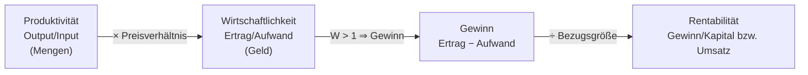

## Überblick

Unternehmen brauchen Ziele, an denen sie ihren Erfolg messen. Die Vorlesung unterscheidet **Formalziele** (übergeordnete Erfolgsziele) und **Sachziele** (konkretes Handeln). Für die Formalziele gibt es drei zentrale Kennzahlen: **Produktivität**, **Wirtschaftlichkeit** und **Gewinn/Rentabilität**. Aussagekräftig werden sie erst durch **Vergleiche (Benchmarking)**.

> [!KLAUSUR]
> Hier wird **gerechnet**. Die drei Kennzahlen musst du sicher berechnen, interpretieren und voneinander abgrenzen können – vor allem die **Gesamtkapitalrentabilität mit Fremdkapitalzinsen**.

## Formal- und Sachziele

| | **Formalziele** | **Sachziele** |
|---|---|---|
| Beschreibung | übergeordnete Ziele, an denen sich die Sachziele ausrichten („**Erfolgsziele**“) | beziehen sich auf das **konkrete Handeln** |
| Ziele | **Produktivität**, **Wirtschaftlichkeit**, **Gewinn und Rentabilität** | **Leistungsziele**, **Finanzziele**, **Führungs- und Organisationsziele**, **soziale und ökologische Ziele** |
| Messung | **Effizienz** | **Effektivität** |

> [!BEISPIEL] Sachziele eines Softwarehauses
> - **Leistungsziel:** Release 3.0 bis Q2 mit 99,9 % Verfügbarkeit
> - **Finanzziel:** Liquidität für 12 Monate sichern
> - **Führungs-/Organisationsziel:** agile Teams einführen
> - **Soziales/ökologisches Ziel:** Rechenzentrum zu 100 % mit Ökostrom betreiben

Ausgangspunkt der Formalziele ist die Frage nach dem **optimalen Einsatz der Produktionsfaktoren**.

| # | Kennzahl | Was wird verglichen? | Formel | Dimension |
|---|---|---|---|---|
| 1 | **Produktivität** | Output und Input in **Mengen** | Output / Input | z. B. Stück/kg |
| 2 | **Wirtschaftlichkeit** | Ertrag und Aufwand in **Geld** | Ertrag / Aufwand | dimensionslos |
| 3 | **Gewinn** | Ertrag minus Aufwand (**absolut**) | Ertrag − Aufwand | € |
| 3 | **Rentabilität** | Gewinn zu einer Bezugsgröße (**relativ**) | Gewinn / Bezugsgröße | % |

## Produktivität

> [!DEFINITION] Produktivität
> **Mengenmäßiges** Verhältnis zwischen Output und Input eines Produktionsprozesses. Eine rein **technische Messzahl**.

> [!FORMEL]
> $$\text{Produktivität} = \frac{\text{Output (Menge)}}{\text{Input (Menge)}}$$

- Gemessen in technischen Dimensionen wie **Stückzahl, Gewicht, Zeit**.
- Sagt etwas über die **quantitative Ergiebigkeit** der Faktorkombination aus und legt die **Effizienz der Fertigung** offen (bezogen auf eine Zeiteinheit).

> [!BEISPIEL] PC AG – Blechproduktivität
> - März: 500.000 Notebooks aus 100 t Blech → $\frac{500.000}{100} = 5.000$ Notebooks/t
> - April: 600.000 Notebooks aus 100 t Blech → $6.000$ Notebooks/t
> - Die Produktivität steigt um **20 %**.

### Teilproduktivitäten

Eine Gesamtproduktivität ist schwer zu bilden, weil die Inputs in verschiedenen Einheiten vorliegen (kg, h, m²). Deshalb misst man **Teilproduktivitäten** je Produktionsfaktor:

| Teilproduktivität | Formel | Beispiel |
|---|---|---|
| **Arbeitsproduktivität** | Output / Arbeitsstunden | Infas AG: 100 Fragebögen in 8 h = **12,5/h**; nach Schulung 120 = **15/h** (+20 %) |
| **Flächenproduktivität** | Umsatz / m² | dm 2016: **7.168 €/m²** |
| **Maschinenproduktivität** | Stück / Maschinenstunde | Dosenfabrik: 1.800 Dosen/h |

### Praxisbeispiele

| Vergleich | Werte | Aussage |
|---|---|---|
| Flächenproduktivität Drogerien **2010** (€/m²) | dm 6.500 · Rossmann 5.000 · Müller 4.000 · Schlecker 2.200 | dm Spitzenreiter |
| Flächenproduktivität Drogerien **2016** (€/m²) | dm 7.168 · Rossmann 5.331 · Budnikowsky 5.093 · Müller 4.490 | dm weiter vorn |
| Produktionszeit pro Pkw **2008** (h) | Nissan 14 · Ford 17 · Opel 17 · Toyota 21 · VW 35 · BMW 40 | Nissan braucht 65 % weniger Zeit als BMW |
| VW Golf, Produktionszeit pro Einheit (h) | 2004: 44 → 2008: 35 → 2013: 25 | **−43 %** |

> [!INFO]
> Die Folie nennt für Nissan vs. BMW **−64 %**. Nachgerechnet ergibt sich $\frac{14 - 40}{40} = -65\,\%$. In der Klausur den Rechenweg zeigen.

## Wirtschaftlichkeit

> [!DEFINITION] Wirtschaftlichkeit
> Verhältnis zwischen dem **in Geld bewerteten Ertrag** und dem **in Geld bewerteten Einsatz** an Produktionsfaktoren (Aufwand).

> [!FORMEL]
> $$\text{Wirtschaftlichkeit} = \frac{\text{Ertrag}}{\text{Aufwand}}$$

- **Dimensionslos** (€/€) und stets auf eine **Zeiteinheit** bezogen.

| Wert | Bedeutung |
|---|---|
| $W > 1$ | **Gewinn** |
| $W = 1$ | weder Gewinn noch Verlust |
| $W < 1$ | **Verlust** |

> [!BEISPIEL] PC GmbH
> - März: 100 Workstations für 250.000 € verkauft, Aufwand 250.000 € → $W = 1{,}0$
> - April: Preiserhöhung, Ertrag 300.000 € bei gleichem Aufwand → $W = 1{,}2$
>
> Die Produktivität ist **unverändert** (gleiche Mengen), die Wirtschaftlichkeit ist trotzdem gestiegen – allein durch den Preis.

## Gewinn und Rentabilität

| | Definition | Formel |
|---|---|---|
| **Gewinn** | **absolute** positive Differenz zwischen Ertrag und Aufwand = Vermögenszuwachs | Gewinn = Ertrag − Aufwand (= Umsatz − Kosten) |
| **Rentabilität** | **relative** Größe: Gewinn im Verhältnis zu einer Bezugsgröße | Rentabilität = Gewinn / Bezugsgröße |

> [!FORMEL] Rentabilitätskennzahlen (Schiereck)
> $$\text{Umsatzrentabilität} = \frac{\text{Gewinn}}{\text{Umsatz}} \cdot 100\,\%$$
> $$\text{Eigenkapitalrentabilität} = \frac{\text{Gewinn}}{\text{Eigenkapital}} \cdot 100\,\%$$
> $$\text{Gesamtkapitalrentabilität} = \frac{\text{Gewinn} + \text{Fremdkapitalzinsen}}{\text{Gesamtkapital}} \cdot 100\,\%$$

> [!WARNUNG]
> Bei der **Gesamtkapitalrentabilität** werden die **Fremdkapitalzinsen zum Gewinn addiert**. Das Gesamtkapital bringt nämlich auch den Fremdkapitalgebern eine Verzinsung. Das Weglassen der Zinsen ist der häufigste Rechenfehler.

> [!BEISPIEL] PC GmbH – alle drei Rentabilitäten
> Gegeben: Eigenkapital 100.000 €, Fremdkapital 60.000 € zu 6 %, Gewinn 8.000 €, Umsatz 330.000 €.
>
> 1. Fremdkapitalzinsen: $60.000 \cdot 0{,}06 = 3.600$ €
> 2. Gesamtkapital: $100.000 + 60.000 = 160.000$ €
> 3. Umsatzrentabilität: $\frac{8.000}{330.000} = 2{,}42\,\%$
> 4. Eigenkapitalrentabilität: $\frac{8.000}{100.000} = 8\,\%$
> 5. Gesamtkapitalrentabilität: $\frac{8.000 + 3.600}{160.000} = 7{,}25\,\%$

### Praxisbeispiel: Technologiefirmen 2013 (Bloomberg)

| Unternehmen | Gewinn (Mrd. $) | Umsatz (Mrd. $) | Umsatzrendite | EK-Rendite |
|---|---|---|---|---|
| Oracle | 10,9 | 37,2 | **29 %** | 25 % |
| Microsoft | 21,9 | 77,9 | 28 % | 30 % |
| Apple | **37,0** | 170,9 | 22 % | 31 % |
| Google | 10,7 | 50,2 | 21 % | 16 % |
| SAP | 4,3 | 21,8 | 20 % | 22 % |
| IBM | 16,5 | 99,8 | 17 % | **72 %** |
| Siemens | 5,6 | 98,7 | 6 % | 14 % |
| HP | 5,1 | 112,3 | 5 % | 20 % |
| Dell | 2,4 | 56,9 | 4 % | 13 % |

> [!MERKE]
> Der höchste **absolute Gewinn** (Apple) ist nicht die höchste **Rendite** (Oracle bei der Umsatzrendite, IBM beim Eigenkapital). Software hat hohe Margen; Hardware- und Mischkonzerne (Siemens, HP, Dell) haben niedrige.

## Zusammenhang der Kennzahlen

- **Produktivität ↔ Wirtschaftlichkeit:** Produktivität ist das **mengenmäßige**, Wirtschaftlichkeit das **wertmäßige** Output/Input-Verhältnis. Höhere Produktivität steigert bei konstanten Preisen auch die Wirtschaftlichkeit. Die Wirtschaftlichkeit kann aber auch **allein durch Preise** steigen (PC GmbH).
- **Wirtschaftlichkeit ↔ Rentabilität:** $W > 1$ bedeutet Gewinn. Die Rentabilität setzt diesen Gewinn ins Verhältnis zu einer Bezugsgröße. Ohne $W > 1$ gibt es keine positive Rentabilität.

## Benchmarking: Aussagekraft durch Vergleiche

Eine Kennzahl allein sagt wenig. Erst der **Vergleich** macht sie aussagekräftig. Vier Formen nach Referenzobjekt:

| Vergleich | Vergleichsobjekt | Beispiel |
|---|---|---|
| **Soll-Ist-Vergleich** | eigener **Plan** | Ziel 10 % Umsatzrendite, erreicht 8 % |
| **Betriebsvergleich** | **Wettbewerber** | Produktionszeit Nissan vs. BMW |
| **Periodenvergleich** | eigene **Vorperioden** (Monat, Jahr, Vorjahresmonat) | Golf-Produktionszeit 2004–2013 |
| **Branchenvergleich** | Unternehmen **anderer Branchen** | Umsatzrenditen verschiedener Branchen |

## Rechenbeispiel: Dosenfabrikant

> [!INFO]
> Die Lösungsfolien fehlen in der Studierendenversion. Der Lösungsweg unten ist nachgerechnet, aber **nicht offiziell bestätigt**. Er nimmt an, dass der Blecheinsatz konstant bei 50 kg bleibt.

**Aufgabe:** Aus 50 kg Blech werden 300 Dosen hergestellt (10 % Blechausschuss, 2 s Maschinenzeit pro Dose).

**a) Produktivitäten**
- Blechproduktivität: $\frac{300 \text{ Dosen}}{50 \text{ kg}} = 6$ Dosen/kg
- Maschinenproduktivität: $\frac{3.600 \text{ s/h}}{2 \text{ s/Dose}} = 1.800$ Dosen/h

**b) Ausschuss auf 4 % senken, dafür 2,2 s pro Dose**
- Blechbedarf pro Dose: $\frac{50 \cdot 0{,}9}{300} = 0{,}15$ kg
- Nutzbares Blech neu: $50 \cdot 0{,}96 = 48$ kg → $\frac{48}{0{,}15} = 320$ Dosen
- Blechproduktivität: $\frac{320}{50} = 6{,}4$ Dosen/kg (↑)
- Maschinenproduktivität: $\frac{3.600}{2{,}2} \approx 1.636$ Dosen/h (↓)

**c) Wirtschaftlichkeit** (Blech 1,20 €/kg, Preis 0,30 €/Dose, Maschinenstunde 90 €)

| | Variante 1 (10 % Ausschuss) | Variante 2 (4 % Ausschuss) |
|---|---|---|
| Ertrag | $300 \cdot 0{,}30 = 90{,}00$ € | $320 \cdot 0{,}30 = 96{,}00$ € |
| Blech | $50 \cdot 1{,}20 = 60{,}00$ € | $60{,}00$ € |
| Maschine | $600 \text{ s} = \frac{1}{6} \text{ h} \cdot 90 = 15{,}00$ € | $704 \text{ s} \cdot \frac{90}{3.600} = 17{,}60$ € |
| Aufwand | 75,00 € | 77,60 € |
| **Wirtschaftlichkeit** | $\frac{90}{75} = 1{,}20$ | $\frac{96}{77{,}60} \approx 1{,}24$ |

→ **Variante 2** ist wirtschaftlicher, obwohl die Maschinenproduktivität sinkt. Teilproduktivitäten können sich widersprechen; die Wirtschaftlichkeit fasst sie in Geld zusammen.
