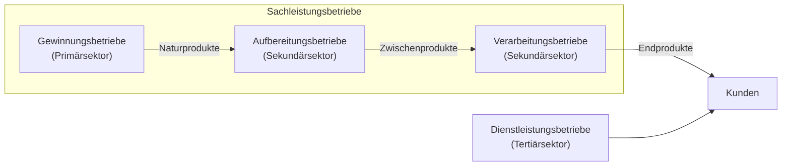
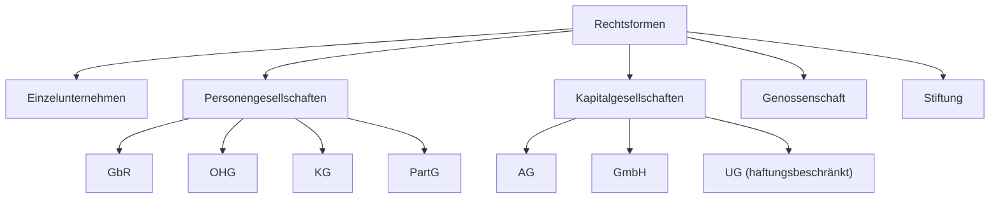
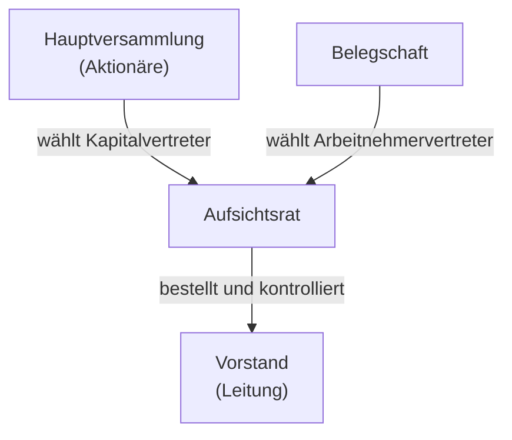

## Überblick

Unternehmen sind sehr verschieden – ein Hidden Champion aus Regensburg, ein DAX-Konzern, ein Ein-Personen-Start-up. Um sie vergleichen und Entscheidungen treffen zu können, ordnet man sie nach **fünf Kriterien**:

1. **Branche**
2. **Größe**
3. **Technisch-ökonomische Struktur**
4. **Rechtsform**
5. **Standort**

> [!KLAUSUR]
> Viel **Auswendiglernen**: HGB-Größenklassen, Bindungsintensität der Unternehmensverbindungen, Mindestkapital, AG-Organe, Mitbestimmungsschwellen. Dazu kommt die **Nutzwertanalyse** als Rechenaufgabe. Nutze die Karteikarten konsequent.

## Branche

### Sachleistungs- vs. Dienstleistungsbetriebe

### Wirtschaftssektoren einer Volkswirtschaft

| Sektor | Bezeichnung | Beispiel |
|---|---|---|
| **Primär** | Urproduktion (Gewinnung) | Landwirtschaft, Bergbau |
| **Sekundär** | Industrieller Sektor (Aufbereitung, Verarbeitung) | Stahlwerk, Automobilbau |
| **Tertiär** | Dienstleistungssektor | Bank, Beratung, Handel |
| **Quartär** | Informationssektor | IT-Dienstleister, Datenanalyse |

> [!DEFINITION] Drei-Sektoren-Theorie (Fourastié, 1954)
> Der Schwerpunkt der Wirtschaftstätigkeit verlagert sich historisch vom **primären** (Agrar) über den **sekundären** (Industrie) zum **tertiären Sektor** (Dienstleistung).

Beispiel: Agrarland → Industrieland → Dienstleistungsgesellschaft (wie Deutschland heute).

## Größe

### Größenklassen nach § 267 HGB (Kapitalgesellschaften)

| Klasse | Mitarbeitende | Bilanzsumme | Umsatz |
|---|---|---|---|
| **klein** | bis 50 | bis 7,5 Mio. € | bis 15 Mio. € |
| **mittelgroß** | bis 250 | bis 25 Mio. € | bis 50 Mio. € |
| **groß** | über 250 | über 25 Mio. € | über 50 Mio. € |

> [!MERKE]
> Eine Gesellschaft fällt in eine Klasse, wenn sie **mindestens zwei der drei Kriterien** erfüllt.

**Rechtsfolgen:**
- Alle Kapitalgesellschaften müssen einen **Jahresabschluss erstellen (§ 264 HGB)** und ihn im Unternehmensregister **offenlegen (§ 325 HGB)**.
- **Mittelgroße und große** Kapitalgesellschaften werden durch einen **Wirtschaftsprüfer geprüft**.
- Für **KMU** gibt es Erleichterungen (**§ 288 HGB**).

### Größenklassen der EU-Kommission

| Kategorie | Mitarbeitende | Bilanzsumme | Umsatz |
|---|---|---|---|
| **Mikro** | bis 9 | bis 2 Mio. € | bis 2 Mio. € |
| **Klein** | bis 49 | bis 10 Mio. € | bis 10 Mio. € |
| **Mittel** | bis 249 | bis 43 Mio. € | bis 50 Mio. € |
| **Groß** | über 249 | über 43 Mio. € | über 50 Mio. € |

Die EU-Kriterien dienen vor allem zur **Eingrenzung von Förderprogrammen**.

> [!WARNUNG]
> HGB und EU verwenden **unterschiedliche** Schwellen. HGB: 50 / 250 Mitarbeitende. EU: 9 / 49 / 249 Mitarbeitende und eine zusätzliche Klasse „Mikro“. Achte in der Aufgabe darauf, welche Definition gefragt ist.

### Zahlen Deutschland 2020 (Destatis)

| | Kleinste | Kleine | Mittlere | **Große** |
|---|---|---|---|---|
| Unternehmen | ca. 2,06 Mio. | 346.943 | 62.217 | **15.507** |
| Beschäftigte | 5,38 Mio. | 6,04 Mio. | 4,81 Mio. | **13,21 Mio.** |
| Wertschöpfung (Mio. €) | 201.480 | 281.131 | 287.084 | **1.048.886** |

> [!MERKE]
> **Weniger als 1 %** der Unternehmen sind groß, erwirtschaften aber **mehr als 50 %** der Wertschöpfung. Nach Marktkapitalisierung sind **15 der 20 größten** Unternehmen der Welt US-amerikanisch.

### Unternehmensverbindungen nach Bindungsintensität

Von **schwach** nach **stark**:

1. **Agreements**
2. **Partizipation**
3. **Konsortium**
4. **Wirtschaftsverbände**
5. **Kartell**
6. **Gemeinschaftsunternehmen** (strategische Allianz = Contractual Joint Venture; Equity Joint Venture)
7. **Konzern**
8. **Verschmelzung** (Fusion, Merger)

| | **Konsortium** | **Kartell** | **Konzern** |
|---|---|---|---|
| Wesen | vertragliche Verbindung zur Abwicklung **genau abgegrenzter Projekte** | vertragliche Verbindung mit dem Ziel, den **Wettbewerb zu beschränken** | Zusammenschluss von **mind. zwei rechtlich selbstständig bleibenden** Unternehmen unter **gemeinsamer Leitung** |
| Merkmal | Konsorten bleiben rechtlich **und** wirtschaftlich selbstständig; **Risikoverteilung** | **verboten** nach **GWB** | **wirtschaftliche Einheit** |
| Beispiel | DVB-T2 | Bier, Stahl, Zucker, Öl, Aufzugbauer, Schokolade | Lufthansa (Eurowings, Swiss, Austrian, LH Cargo, LH Technik, LSG Sky Chefs …) |

> [!INFO] Kartellanfällige Märkte
> Besonders anfällig sind Märkte mit **wenigen Anbietern**, **homogenen Produkten**, **hohen Markteintrittsbarrieren** und **stabiler Nachfrage** (z. B. Zucker, Zement, Stahl).

### Mittelstand – qualitative Abgrenzung

> [!DEFINITION] Mittelstand (Gilbert/Schedel)
> - **Einheit von Eigentum, Haftung und Führung**
> - **Entscheidungsunabhängigkeit** des Unternehmers (Konzernunabhängigkeit)
> - **Weitgehende Verantwortlichkeit** des Unternehmers für alle unternehmensrelevanten Entscheidungen

### Hidden Champions

> [!DEFINITION] Hidden Champion
> Unternehmen, das **Nr. 1–3 am Weltmarkt** ist, einen **Umsatz unter 3 Mrd. €** hat und in der Öffentlichkeit **kaum bekannt** ist.

**10 Erfolgsfaktoren nach Hermann Simon** (2007, Analyse von 1.316 deutschen Hidden Champions):

1. Klare und ambitiöse Zielsetzungen
2. Enger Marktfokus
3. Globale Orientierung
4. Nähe zum Kunden
5. Kontinuierliche Innovation
6. Fokus auf eigene Kernkompetenzen
7. Aufbau klarer Wettbewerbsvorteile
8. Gleichzeitiger Fokus auf Technologie- und Marktorientierung
9. Selektierte und hoch motivierte Mitarbeiter
10. Starke Führerschaft durch das Top-Management

**Regionale Hidden Champions (Ostbayern):**

| Firma | Produkte | Standort | Umsatz (Mio. €) | Mitarbeiter |
|---|---|---|---|---|
| Kromberg & Schubert | Bordnetze, Kabelsysteme | Abensberg | k. A. | 26.000 |
| Grammer | Automobilzulieferer, Sitze | Amberg | 1.144,0 | 8.672 |
| Zollner Elektronik | Induktive Bauelemente, Flachbaugruppen | Zandt | 871,6 | 8.100 |
| Maschinenfabrik Reinhausen | Stufenschalter für Transformatoren | Regensburg | 750 | 3.550 |
| Mühlbauer | Smart Cards, Halbleiter-Back-End | Roding | 237,2 | 2.762 |
| BHS Corrugated | Wellpappenanlagen | Weiherhammer | 270,0 | 1.500 |

## Technisch-ökonomische Struktur

| **Vorherrschender Produktionsfaktor** | **Fertigungstyp** (Anzahl Produkte) | **Fertigungsverfahren** (Anordnung der Maschinen) |
|---|---|---|
| personalintensiv | **Einzelfertigung** (z. B. auftragsbezogen) | **Werkstattprinzip** (nach Funktionen: Stanzen, Bohren, Drehen, Schleifen) |
| anlagenintensiv | **Mehrfachfertigung** (z. B. Massenfertigung) | **Fließprinzip** (Arbeitsteilung, Spezialisierung) |
| materialintensiv | | |
| energieintensiv | | |
| informationsintensiv | | |

> [!MERKE]
> **Einzelfertigung** passt zum **Werkstattprinzip** (flexibel, jedes Stück anders). **Massenfertigung** passt zum **Fließprinzip** (Maschinen in Arbeitsfolge, hoch spezialisiert).

## Rechtsform

Die Wahl der Rechtsform ist eine **strategische Entscheidung**. Entscheidungsfaktoren:

1. **Leitungs- und Kontrollbefugnis**
2. **Haftungsumfang** der Eigenkapitalgeber
3. **Gewinn- und Verlustbeteiligung**
4. **Finanzierungsmöglichkeiten**
5. **Publizität und Prüfung**
6. **Mitbestimmung** der Arbeitnehmer
7. **Steuerbelastung**

In Deutschland sind **Einzelunternehmen** und **GmbHs** zahlenmäßig am häufigsten.

### Einzelunternehmen

- Eine **natürliche Person** betreibt eine selbstständige Tätigkeit
- kein oder nur ein **stiller Gesellschafter**
- **unbeschränkte Haftung** (Betriebs- und Privatvermögen)
- Gründung **formlos**; mit Eintragung ins Handelsregister ist der Inhaber **Kaufmann**
- **„Firma“** = der Name, unter dem der Kaufmann seine Geschäfte betreibt

### Personen- vs. Kapitalgesellschaften

| Merkmal | **Personengesellschaften** | **Kapitalgesellschaften** |
|---|---|---|
| Rechtspersönlichkeit | natürliche Personen | **juristische Person** |
| Gründung | einfacher | komplexer, kostenintensiver |
| Haftung | mind. ein Gesellschafter haftet mit **Privatvermögen** | beschränkt auf das **eingelegte Kapital** |
| Geschäftsführung / Vertretung | nur **vollhaftende** Gesellschafter | Geschäftsführung (Kapitalbeteiligung nicht nötig) |
| Abstimmung | **nach Köpfen** | **nach Kapitalanteilen** |
| Mindestkapital | **nein** | **ja**: GmbH 25.000 €, AG 50.000 € |
| Überwachungsorgan | kein spezielles (freiwillig möglich) | gesetzlich vorgeschriebenes **Aufsichtsorgan** |

### Aktiengesellschaft (AG)

- Die Eigenkapitalgeber beteiligen sich über **Aktien**, also Mitgliedschaftsrechte als **handelbares Wertpapier**.
- In Deutschland gibt es ca. **7.000 AGs und KGaAs**, davon ca. **1.000 börsennotiert**; die **40 größten** bilden den **DAX**.
- Durch breite Streuung lassen sich große Mengen Eigenkapital über **Aktienemissionen** beschaffen; starke Regulierung durch das **AktG**.

> [!MERKE] Rechte des Aktionärs
> 1. **Stimmrecht** in der Hauptversammlung
> 2. Recht auf Gewinnanteil (**Dividende**)
> 3. **Bezugsrecht** bei Kapitalerhöhungen
> 4. Anteil am **Liquidationserlös**

### Genossenschaft

- **Nicht geschlossene** Mitgliederzahl: Deutschland mindestens **7**, EU (SCE) mindestens **5** Mitglieder
- Zweck: **Förderung des Erwerbs oder der Wirtschaft ihrer Mitglieder** durch einen gemeinsamen Geschäftsbetrieb
- **Juristische Person**, keine persönliche Haftung der Mitglieder (sofern die Satzung nichts anderes regelt)
- Organe: **Vorstand, Aufsichtsrat, Generalversammlung**; bei mehr als 1.500 Mitgliedern ggf. **Vertreterversammlung**
- Rechtsgrundlage: **GenG** (seit **1869**); Europäische Genossenschaft **SCE** seit **2006**

### Rechtsformen im Vergleich (Wöhe)

| Merkmal | **Einzelunternehmen** | **OHG** | **KG** |
|---|---|---|---|
| Rechtsgrundlage | §§ 1–104 HGB | §§ 105–160 HGB | §§ 161–177a HGB |
| Leitung | Eigentümer | alle oder einzelne Gesellschafter | **Komplementär(e)** |
| Kontrolle | Eigentümer | alle Gesellschafter | voll: Komplementäre; beschränkt: **Kommanditisten** |
| Haftung | unbeschränkt | unbeschränkt, alle als **Gesamtschuldner** | Komplementäre unbeschränkt, Kommanditisten **beschränkt** |
| Mindest-EK | keine | keine | keine |
| Finanzierung | durch Vermögen und Kreditwürdigkeit des Inhabers begrenzt | besser als EU (mehrere Vollhafter) | besser als EU/OHG (Teilhafter bringen Kapital) |
| Publizität / Mitbestimmung | nicht erforderlich (Ausnahme: Großunternehmen) / keine | wie EU | wie EU |

| Merkmal | **AG** | **GmbH** | **Genossenschaft** |
|---|---|---|---|
| Rechtsgrundlage | AktG | GmbHG | GenG |
| Leitung | **Vorstand** | **Geschäftsführer** (Weisungsrecht der Gesellschafterversammlung) | Vorstand |
| Kontrolle | **Aufsichtsrat**; beschränkte Informationsrechte der HV | Gesellschafterversammlung | Aufsichtsrat; beschränkt General-/Vertreterversammlung |
| Haftung | Gesellschaft unbeschränkt, Aktionäre beschränkt | Gesellschaft unbeschränkt, Gesellschafter beschränkt | Genossenschaft unbeschränkt, Mitglieder beschränkt, ggf. **Nachschusspflicht** |
| Mindest-EK | **50.000 €** | **25.000 €** (UG: **1 €**) | keine Vorschrift |
| Finanzierung | **hervorragend** (kleine Anteile, Börse, Kapitalmarkt) | Haftungsbeschränkung, aber Gläubiger verlangen oft Zusatzsicherheiten | Mitgliederanteile, Mitgliederdarlehen, Kapitalmarkt |
| Publizität / Prüfung | zwingend | zwingend | zwingend |

> [!FORMEL] Mitbestimmung im Aufsichtsrat (Kapitalgesellschaften)
> - **Drittelparität:** über 500 bis unter 2.000 Beschäftigte (⅓ Arbeitnehmervertreter)
> - **Unterparität:** über 2.000 Beschäftigte
> - **Volle Parität:** **Montanbetriebe** (Bergbau, Eisen, Stahl) ab 1.000 Beschäftigten – gilt nicht für Genossenschaften

## Standort

> [!DEFINITION] Standort
> Der **geografische Ort**, an dem ein Unternehmen seine **Produktionsfaktoren** einsetzt.

### Grad der geografischen Ausbreitung

| Ausbreitung | Merkmal | Beispiel |
|---|---|---|
| lokal / regional / national | Tätigkeit innerhalb dieser Grenzen | Bäckerei, regionale Bank |
| **international** | produziert hauptsächlich im **Inland**, **exportiert** aber | Heidelberger Druckmaschinen AG |
| **multinational** | **produzierende Tochtergesellschaften in mehreren Ländern** | Siemens AG |

### Standortfaktoren

| Faktor | Beispiele |
|---|---|
| **arbeitsbezogen** | Zahl, Kosten und Qualität der Arbeitskräfte |
| **materialbezogen** | Transportkosten, Zuliefersicherheit, Art des Produkts |
| **absatzbezogen** | Transportfähigkeit, Kundennähe |
| weitere | **verkehrs-**, **immobilien-**, **umweltschutz-**, **abgabenbezogen**, **Clusterbildung**, **rechtlich/politisch** |

> [!BEISPIEL] Standortentscheidungen
> - **New Zealand Aluminium Smelters (1971):** Die energieintensive Aluminiumproduktion wurde an ein vertraglich gebundenes **Wasserkraftwerk** in nahen Fjorden gekoppelt → **materialbezogener** Standortfaktor.
> - **VW-Werk Chattanooga (USA, 2011):** Ziel war die Markterschließung (**absatzbezogen**, Kundennähe). US-Verkäufe 2010: 257.000 → 2011: 324.000 (**+27 %**) → 2012: 438.000 → 2015: 349.000. Die Markterschließung gelang, die Wachstumsdynamik ließ danach nach.

**Produktion im Ausland – eine Win-win-Situation?**

| aus Sicht ausländischer Investoren | aus Sicht des Gastlandes |
|---|---|
| geförderte Investition (günstige Grundstücke, Steuervorteile) | Technologiewissen in strukturschwachen Regionen aufbauen |
| preisgünstiger Materialbezug | zusätzlicher Markt für regionale Zulieferer |
| niedrige Lohnkosten | Beschäftigung und Ausbildung für gering qualifizierte Arbeitskräfte |
| wettbewerbsfähig im Absatzmarkt produzieren | Produkte günstig im Land statt teurer Importe |

### Nutzwertanalyse

Die Nutzwertanalyse ist ein **Punktbewertungsverfahren** und eine Entscheidung bei **Sicherheit mit Zielgewichtung** (vgl. Entscheidungsregeln in Modul 1).

> [!FORMEL]
> $$\text{Nutzwert}_j = \sum_i \text{Gewicht}_i \cdot \text{Bewertung}_{ij}$$
> Bewertung z. B. 1 = schlecht, 3 = mittel, 5 = gut. Die Alternative mit dem **höchsten Nutzwert** wird empfohlen.

> [!BEISPIEL] Standortwahl aus der Vorlesung (Gewichte, Summe 120)
>
> | Kriterium | Gew. | Brasilia | Prag | Moskau |
> |---|---|---|---|---|
> | Mitarbeiterkosten | 25 | 5 → 125 | 3 → 75 | 3 → 75 |
> | Mitarbeiterqualifikation | 30 | 1 → 30 | 3 → 90 | 5 → 150 |
> | Infrastruktur | 15 | 1 → 15 | 5 → 75 | 3 → 45 |
> | Materialverfügbarkeit | 35 | 5 → 175 | 1 → 35 | 3 → 105 |
> | politische Stabilität | 15 | 3 → 45 | 5 → 75 | 1 → 15 |
> | **Nutzwert** | | **390** | **350** | **390** |
>
> Brasilia und Moskau liegen gleichauf. Die Gewichtung entscheidet, und das Ergebnis ist eine **Entscheidungshilfe, keine Entscheidung**.

| Vorteile | Nachteile |
|---|---|
| leicht anzufertigen | basiert auf ausgewählten Faktoren → für strategische Entscheidungen unvollständig |
| anschauliche Darstellung | beruht auf **subjektiven Präferenzen** |
| Quantifizierung mit relativ geringem Informationsbedarf | **Gewichtungs- und Bewertungsproblem** |
| kommunikativ, fördert die Diskussion strategischer Fragen | keine vollkommenen Informationen (Klein- vs. Großunternehmen) |
| | **statische** (zeitpunktbezogene) Betrachtung |
