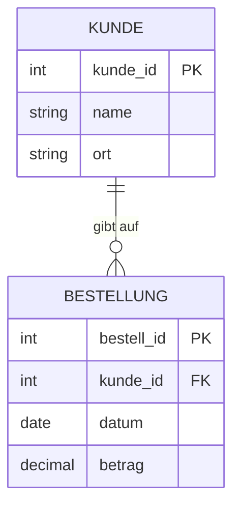

## Überblick

Das **relationale Modell** (Codd, 1970) speichert Daten in Tabellen. Fast jedes betriebliche Informationssystem – ERP, CRM, Webshop – baut darauf auf. Für die Klausur zählen drei Dinge: die **Begriffe** sauber definieren, **Schlüssel** begründen und **SQL** schreiben können.

> [!KLAUSUR]
> Definitionen werden fast immer wörtlich abgefragt („Definieren Sie den Begriff Fremdschlüssel.“). Lerne sie mit Karteikarten, nicht durch Lesen.

## Grundbegriffe

> [!DEFINITION] Relation
> Eine Relation ist eine Menge von Tupeln über einer festen Menge von Attributen. Formal: $R \subseteq D_1 \times D_2 \times \dots \times D_n$.

| Begriff | Alltagssprache | Beispiel |
|---|---|---|
| Relation | Tabelle | `Kunde` |
| Tupel | Zeile / Datensatz | `(1, 'Müller', 'Köln')` |
| Attribut | Spalte | `Ort` |
| Domäne | Wertebereich | `Ort ∈ Zeichenketten` |
| Grad | Anzahl Attribute | 3 |
| Kardinalität | Anzahl Tupel | 1 250 |

> [!WARNUNG]
> „Kardinalität einer Relation“ (= Anzahl Tupel) ist etwas anderes als „Kardinalität einer Beziehung“ im ER-Modell (1:1, 1:n, n:m). In der Klausur immer aus dem Kontext klären.

## Schlüssel

- **Superschlüssel:** Attributmenge, die jedes Tupel eindeutig identifiziert.
- **Schlüsselkandidat:** *minimaler* Superschlüssel – kein Attribut kann weggelassen werden.
- **Primärschlüssel (PK):** der ausgewählte Schlüsselkandidat.
- **Fremdschlüssel (FK):** Attribut(e), die auf den Primärschlüssel einer anderen Relation verweisen und so **referenzielle Integrität** sichern.



> [!MERKE]
> Bei einer **1:n-Beziehung** wandert der Fremdschlüssel immer auf die **n-Seite** (hier: `Bestellung.kunde_id`).

## SQL-Grundgerüst

```sql
SELECT   spalten          -- 5. was ausgeben?
FROM     tabelle          -- 1. woher?
JOIN     …  ON …          -- 2. verknüpfen
WHERE    bedingung        -- 3. Zeilen filtern
GROUP BY spalten          -- 4. gruppieren (danach HAVING)
ORDER BY spalten;         -- 6. sortieren
```

> [!BEISPIEL] Umsatz pro Ort
> ```sql
> SELECT k.ort, SUM(b.betrag) AS umsatz
> FROM kunde k JOIN bestellung b ON b.kunde_id = k.kunde_id
> GROUP BY k.ort;
> ```

## Kennzahl: Datenbankgröße abschätzen

> [!FORMEL]
> $\text{Speicherbedarf} = \text{Kardinalität} \times \text{Tupelgröße}$

Bei 200 000 Bestellungen à 64 Byte ergeben sich $200\,000 \cdot 64 = 12\,800\,000$ Byte ≈ 12,2 MiB.
