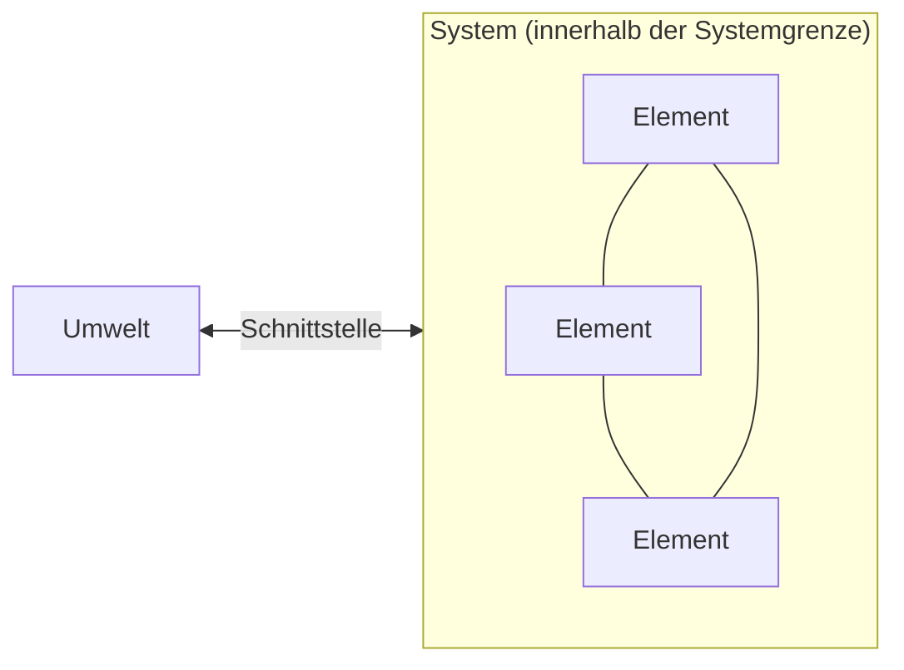

## Überblick

Die Wirtschaftsinformatik (WI) beschäftigt sich mit **Informationssystemen**, also dem Zusammenspiel von Menschen, Aufgaben und Informationstechnik in Organisationen. Dieses Modul legt das Begriffsfundament für die ganze Vorlesung: Was ist ein **System**, was ein **Informationssystem**, was ein **Anwendungssystem**, und welche Arten betrieblicher IS gibt es?

> [!KLAUSUR]
> Die Klausur fragt fast immer die Grundbegriffe ab: Gegenstand der WI, Systembegriff, **soziotechnisch**, IS vs. AWS, Pyramide. Diese Definitionen musst du **wörtlich** wiedergeben können.

## Gegenstand der Wirtschaftsinformatik

> [!DEFINITION] Gegenstand der WI (GI-Empfehlung 2017)
> Gegenstand der Wirtschaftsinformatik sind **Informationssysteme (IS)** in **Wirtschaft, Verwaltung und privatem Bereich**.

Die WI beschäftigt sich mit der **Entwicklung und Anwendung von IS für betriebliche Aufgabenstellungen** in Wirtschaft und Verwaltung.

## Der Systembegriff

> [!DEFINITION] System (allgemeine Systemtheorie)
> Eine Menge von **Elementen**, zwischen denen **Beziehungen und Wechselwirkungen** bestehen und die gegenüber ihrer **Umwelt abgegrenzt** sind. (griech. *systasis* = Zusammenstellung)

| Baustein | Bedeutung |
|---|---|
| **Elemente** | kleinste betrachtete Einheiten; ihre innere Struktur interessiert nicht (wie weit man zerlegt, ist eine Frage der Zweckmäßigkeit) |
| **Beziehungen** | konstante Verbindungen zwischen Elementen; das gesamte Beziehungsgefüge ist die **Systemstruktur** |
| **Umwelt** | Elemente außerhalb der Systemgrenze; innerhalb der Grenze sind die Beziehungen **intensiver** als zur Umwelt |
| **Ziel** | die Elemente arbeiten zusammen, um ein gemeinsames Ziel zu erreichen |
| **Schnittstellen** | über sie kommuniziert das System mit der Umwelt |

> [!MERKE]
> Mehrere **Elemente** arbeiten innerhalb einer **Systemgrenze** zusammen, um ein **Ziel** zu erreichen, und kommunizieren über **Schnittstellen** mit der **Umwelt**.

## Informationssystem (IS)

> [!DEFINITION] Informationssystem (GI 2017)
> IS sind **soziotechnische Systeme**, die **menschliche und maschinelle Komponenten** (Teilsysteme) umfassen.

**Soziotechnisch** heißt: Die Aufgaben werden von **personellen und maschinellen Aufgabenträgern kooperativ** erledigt.

Weitere Definitionen aus der Vorlesung:

- **Laudon/Laudon (2014):** „a set of interrelated components that **collect (or retrieve), process, store, and distribute** information to support **decision making and control** in an organization."
- **Alkhaffaf:** IS umfasst **people, procedures, data, software and hardware**, um digitale Informationen zu sammeln und zu analysieren.

### Die vier Komponenten eines IS

| Komponente | Bedeutung | Beispiel (Online-Shop) |
|---|---|---|
| **Mensch** | Aufgabenträger und Benutzer | Kundenservice-Team |
| **Aufgabe** | zu lösende betriebliche Problemstellung | Bestellungen abwickeln |
| **Informationstechnik** | hard- und softwaretechnische Umsetzung | Shop-Software, Server |
| **Organisatorischer Kontext** | betriebliche Umwelt, in die das IS eingebettet ist | Prozesse, Abteilungen, Regeln |

> [!MERKE] Merkhilfe „MAIO"
> **M**ensch – **A**ufgabe – **I**nformationstechnik – **O**rganisatorischer Kontext

> [!WARNUNG]
> Die WI beschäftigt sich **nicht nur mit Technik**. Dazu gehören auch neue Geschäftsmodelle, Ablauforganisation (Geschäftsprozessmanagement), Human Computer Interaction (HCI) und rechtliche Fragen (Internetrecht).

## Informationssystem vs. Anwendungssystem

> [!DEFINITION] Anwendungssystem (AWS)
> Ein **automatisiertes Teilsystem** eines Informationssystems (GI 2017). Das AWS hat **keinen sozialen Teil**, also keinen Menschen.

| | AWS im **engeren** Sinne | AWS im **weiteren** Sinne |
|---|---|---|
| Umfang | nur die **Anwendungssoftware** | Anwendungssoftware **+ Hardware, Systemsoftware, Kommunikationseinrichtungen** |

### Schalenmodell nach Teubner

| Schale (von innen nach außen) | gehört zu |
|---|---|
| 1. Rechnersystem / **Hardware** | AWS i. w. S. |
| 2. **Systemsoftware** | AWS i. w. S. |
| 3. **Anwendungssoftware** | **AWS i. e. S.** (und i. w. S.) |
| 4. **Kommunikationstechnik** | AWS i. w. S. |
| 5. **Mensch, Organisation, Aufgabe** | nur **Informationssystem** (soziotechnisch) |

> [!MERKE]
> **IS = AWS + Mensch/Organisation/Aufgabe.** Die technischen Schalen bilden das Anwendungssystem, und erst mit der sozialen Schale entsteht das soziotechnische Informationssystem. „Informationssystem“ wird oft synonym mit **IuK-System** (Informations- und Kommunikationssystem) verwendet.

## Fallbeispiel: Freier KFZ-Händler (Ende der 80er)

**Problemkette:** Inkompatible Software → **redundante** Datenerfassung → **inkonsistente** Datenhaltung → nicht alle Daten zentral verfügbar → keine Vertriebsunterstützung (mehrdimensionale Abfragen) → keine Führungsinformationen für die Geschäftsführung.

**Entscheidung:** Reorganisation anhand von **Geschäftsprozessen**.

> [!DEFINITION] Geschäftsprozess
> Eine Folge von Tätigkeiten, die
> - sich an der **Wertschöpfungskette** orientiert und einen **Auslöser** und ein **Ergebnis** hat,
> - teilweise parallel, wiederholend oder alternativ abläuft,
> - **mehrere organisatorische Einheiten** (Abteilungen) einbezieht,
> - aus **Routinetätigkeiten** besteht (keine Einzelprojekte).

Die Konzentration auf **Kernprozesse** und die Beseitigung von Ineffizienzen heißt **Business Process Reengineering (BPR)**.

**Aufgabe des IS:** alle an den Geschäftsprozessen beteiligten Stellen mit allen erforderlichen Informationen versorgen und so vernetzen, dass Informationen zügig ausgetauscht werden können.

**Vorgehen des Wirtschaftsinformatikers:**
1. **Kernprozesse** definieren
2. in **Geschäftsvorgänge** zerlegen (Wer/was ist Auslöser? Wer führt wann was aus?)
3. **Informationsbedarf** ermitteln (Wozu braucht wer wann von wem welche Informationen?)
4. **Alternativen** zur Realisierung des Informationsbedarfs aufstellen

## Ziele der Informationsverarbeitung mittels IS

1. **Rationalisierung** (Kosteneinsparung)
2. Bewältigung **großer Datenmengen**
3. **Beschleunigung** von Geschäftsprozessen
4. Verbesserung von **Qualität und Service**
5. Unterstützung von **Planung, Steuerung und Kontrolle**
6. umfangreiche, komplizierte **Berechnungen** (Operations Research)
7. **neue Organisationsformen**: Workflow Management, Groupware, elektronischer Datenaustausch (EDI), virtuelle Unternehmen
8. **strategische Wettbewerbsvorteile**

## Arten betrieblicher Informationssysteme – die Pyramide

Die Pyramide von **oben (Führung)** nach **unten (operatives Geschäft)**:

| Ebene | Systeme | Zweck |
|---|---|---|
| ▲ Spitze | **MUS auf strategischer Ebene** = Planungs- und Kontrollsysteme | langfristige Unternehmensführung |
| | **MUS auf operativer und taktischer Ebene** | Entscheidungsunterstützung des Managements |
| | **Abfrage- und Berichtssysteme** | Auswertungen, Berichte |
| | **Büro- und Gruppenunterstützung**: individuelle Unterstützung, Gruppenunterstützung, Vorgangsbearbeitung, Büroinformationssysteme | Büroarbeit, Zusammenarbeit |
| ▼ Basis | **Administrations- und Dispositionssysteme = Transaktionssysteme**: F&E, Produktion, Materialwirtschaft, Vertrieb/Marketing; Finanz- und Rechnungswesen, Personalwirtschaft, sonstige Verwaltung | operatives Tagesgeschäft in den Funktionsbereichen |

- **Horizontale Integration:** Verbindung der **Funktionsbereiche** (F&E → Produktion → Materialwirtschaft → Vertrieb) **auf einer Ebene**, entlang der Wertschöpfung
- **Vertikale Integration:** Verbindung **über die Ebenen** hinweg, von den Transaktionssystemen bis zu den MUS
- **Unternehmensübergreifende IS:** **SCM** (Supply Chain Management, Lieferantenseite) und **CRM** (Customer Relationship Management, Kundenseite) umklammern die operativen Systeme

> [!BEISPIEL] Vertikale Integration im Handel
> Jeder Kassenbon wird im **Transaktionssystem** erfasst. Ein **Berichtssystem** verdichtet ihn zum Tagesumsatz je Filiale, und ein **MUS** zeigt der Geschäftsführung den Umsatztrend für die strategische Sortimentsplanung.

## Rolle moderner IS und Digitalisierung

Moderne IS spielen eine zentrale Rolle in nahezu allen ökonomischen, politischen und sozialen Zusammenhängen. Sie sind die **Grundvoraussetzung für die Digitalisierung** von Wirtschaft und Gesellschaft (GI 2017). Beispiel: Amazons **Kiva-Lagerroboter**.

| Perspektive | Definition | Quelle |
|---|---|---|
| **ursprünglich** | Umwandlung von Größen, Werten und Zeichen in **Binärcodes** zur elektronischen Speicherung und Verbreitung (analog → digital) | Becker 2013 |
| **heute** | Übertragung des Menschen und seiner **Lebens- und Arbeitswelten auf eine digitale Ebene** durch verstärkte Anwendung digitaler Technologien | Keuper et al. 2013; Leimeister 2015 |
| **nächste Stufe** | **d!conomy** | Kempf 2015 |

Im allgemeinen Sprachgebrauch umfasst Digitalisierung digitale Produkte (Telefonie, TV, Bücher), digitale Services (soziale Netzwerke), mobile Endgeräte (Smartphones, Wearables), neue Verfahren (mPayment, E-Commerce) und neue Technologien (BLE/Beacons, QR-Code, NFC).
