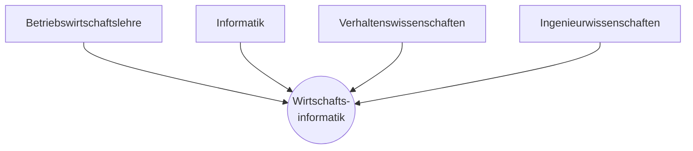
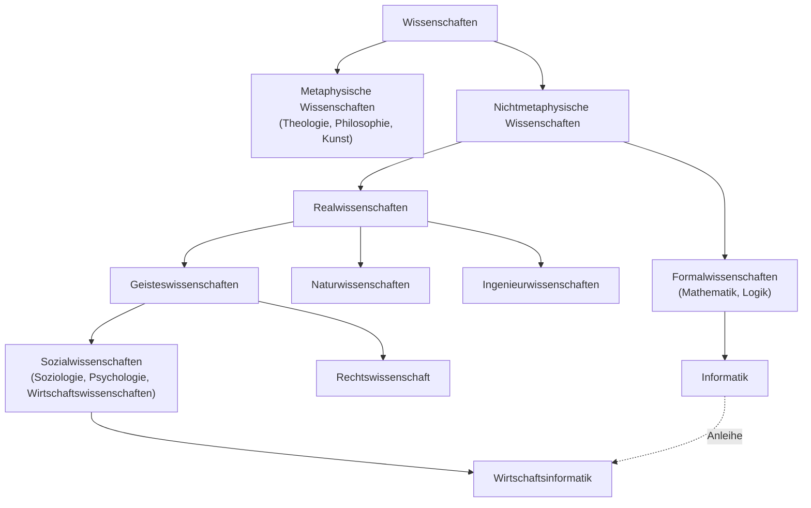

## Überblick

In diesem Modul geht es um die WI **als Wissenschaft**: Welche Ziele verfolgt sie? Wie unterscheidet sie sich von der angloamerikanischen Disziplin *Information Systems*? Wie ist sie entstanden, und auf welchen Disziplinen baut sie auf? Zum Einstieg zeigen gescheiterte ERP-Projekte, warum es diese Disziplin braucht.

> [!KLAUSUR]
> Laut Vorlesung musst du **mindestens zwei der fünf Ziele der WI** nennen können. Typisch sind außerdem Fragen zum Vergleich **IS vs. WI**, zu **Peter Mertens / 1968** und zu den **Basisdisziplinen**.

## Exkurs: Gescheiterte ERP-Projekte

ERP-Umstellungen (Enterprise Resource Planning) gehören zu den riskantesten IT-Projekten überhaupt:

| Unternehmen | Projekt | Was passierte |
|---|---|---|
| **Haribo** | Umstellung auf **SAP S/4HANA** ab Okt. 2018 (10 Länder, 16 Werke) | Warenwirtschaft und Logistik funktionierten nicht → falsche Mengen, leere Regale → **¼ weniger Goldbären-Umsatz** 2018 |
| **Otto** | „Passion for Performance“ (2009–2012) | größtes IT-Projekt der Firmengeschichte, gestoppt: „zu komplex“ |
| **Deutsche Bank** | „Magellan“ (2015) | Integration der Postbank gestoppt; dreistelliger Millionenbetrag |
| **Deutsche Post** | „New Forwarding Environment“ (2015) | **345 Mio. €** (308 Mio. Abschreibung + 37 Mio. Rückstellungen) |
| **Edeka** | „Lunar“ (2007–2012) | Budget 200 Mio. → **350 Mio. €** |
| **Lidl** | „Elwis“ (2011–2018) | nach fast **0,5 Mrd. €** eingestellt |

> [!MERKE]
> Kritisch ist die **Umstellung von Prozessen und Daten aus Altsystemen**. Eine IS-Einführung ist ein **soziotechnisches** Vorhaben (Menschen, Prozesse, Organisation) und kein reines Technikprojekt.

## Die fünf Ziele der WI (GI-Empfehlung 2017)

| | Ziel | Kurz |
|---|---|---|
| a) | (Weiter-)Entwicklung von **Theorien, Methoden und Werkzeugen** zur Gewinnung **intersubjektiv überprüfbarer Erkenntnisse** über IS | **T**heorien |
| b) | **gestaltungsorientierte Konstruktion von IS** sowie (Weiter-)Entwicklung von Konzepten, Vorgehensweisen, Modellen, Methoden, Werkzeugen und (Modellierungs-)Sprachen | **K**onstruktion |
| c) | **realwissenschaftliches Verständnis** von Einsatz, Akzeptanz, Management und Beherrschbarkeit von IS (inkl. Verhalten von Menschen als Aufgabenträger/Anwender) | **V**erständnis |
| d) | primär **wirtschaftswissenschaftlich fundierte Bewertung** von Risiko-, Nutzen- und Wirtschaftlichkeitsdimensionen bei Gestaltung und Einsatz von IS sowie ihrer strategischen und organisatorischen Auswirkungen | **B**ewertung |
| e) | **Prognose** technischer und nichttechnischer Entwicklungen und Auswirkungen des IS-Einsatzes | **P**rognose |

> [!MERKE] Merkhilfe „T-K-V-B-P“
> **T**heorien – **K**onstruktion – **V**erständnis – **B**ewertung – **P**rognose. Die beiden sichersten Antworten sind **(b) Konstruktion** und **(d) wirtschaftliche Bewertung**.

## Paradigmen: Information Systems vs. Wirtschaftsinformatik

| | **Information Systems (IS)** | **Wirtschaftsinformatik (WI)** |
|---|---|---|
| Ausrichtung | **verhaltensorientiert** (behavioristisch) | **anwendungs- und gestaltungsorientiert** (konstruktiv) |
| Sprachraum | angloamerikanisch | deutsch / europäisch |
| Ziel | **kausale, erklärende, vorhersagende Beziehungen** zwischen existierenden IS-Phänomenen ermitteln und validieren | **innovative, nützliche, übertragbare Lösungen** für relevante IS-Gestaltungsprobleme entwickeln und evaluieren |
| Methoden | **quantitativ / empirisch** | **qualitativ**, Nützlichkeit der Lösung, **Design-Theorien** |
| Leitwert | **Rigor** (wissenschaftliche Strenge) | **Relevance** (Praxisrelevanz) |
| Gegenstand | soziale Aspekte soziotechnischer Systeme: Nutzung, Akzeptanz, wahrgenommene Nützlichkeit, Vertrauen; bereits umgesetzte Innovationen | Schnittstelle BWL ↔ Informatik; betriebswirtschaftlicher Nutzen von IS; überwiegend **IT-Artefakte**; näher an technologischen Innovationen |

> [!MERKE] Gemeinsamkeiten
> Beide sind **anwendungsorientierte** Wissenschaften, und beide untersuchen **IS im betrieblichen/organisationalen Kontext**.

> [!BEISPIEL] Forschungsbeispiele
> - **IS** (Information Systems Journal 2019): Wie wirkt die Nutzung von **CRM-Systemen** auf die Serviceleistung von Mitarbeitenden? Ergebnis: Der Nutzen hängt vom **adaptiven Verhalten** der Mitarbeitenden ab → **empirisch, erklärend**.
> - **WI** (BISE 2019): **Restwertprognose** für Leasingfahrzeuge mit **künstlichen neuronalen Netzen** (über 250.000 Leasingverträge) → **gestaltend, ein Artefakt wird gebaut**.

### Eckdaten Information Systems

- keine allgemein anerkannte Definition; Schwerpunkt: Auswahl, Einführung, Betrieb und Betreuung von IuK-Systemen
- 1972/73 erstes Modell-Curriculum der **ACM** (Association for Computing Machinery); 1997 gemeinsames Curriculum von **ACM, AIS** (Association for Information Systems) und **AITP** (Association of Information Technology Professionals)
- zwei Teilgebiete: **Information systems function** (Erwerb, Einführung, Betrieb) und **System development** (Entwurf, Entwicklung, Wartung)

### Empirische Forschung

> [!DEFINITION] Gütekriterien empirischer Forschung
> - **Objektivität** – Nachprüfbarkeit, unabhängig vom Forscher
> - **Reliabilität** – Zuverlässigkeit, d. h. bei Wiederholung gleiche Ergebnisse
> - **Validität** – Gültigkeit, d. h. es wird gemessen, was gemessen werden soll

Ablauf in 5 Schritten: (1) Was und warum erforschen? → (2) Wie forschen? → (3) Rohdaten erheben → (4) Analyse/Auswertung → (5) Darstellung (Tabellen, Grafiken).

## Geschichte der WI im deutschsprachigen Raum

| Jahr | Ereignis |
|---|---|
| **1955** | erste größere **EDV-Anwendung** in Wirtschaft und Verwaltung |
| 1958 | Informatik-Lehrveranstaltungen im BWL-Studium |
| 1963 | Gründung des **BIFOA** (Betriebswirtschaftliches Institut für Organisation und Automation) |
| **1968** | **erster Lehrstuhl für betriebliche Datenverarbeitung – Prof. Peter Mertens** |
| 1974/75 | erste Studienversuche; Gründung der **Wissenschaftlichen Kommission Betriebsinformatik (WKBI)** |
| **1975/76** | erste Studiengänge: Uni/TU Wien, TH Darmstadt („Wirtschaftsinformatik“) |
| 1978 / 1983 | Mertens im Präsidium der **GI**; Gründung des Fachbereichs WI in der GI |
| 1984 / 1986 | DFG fördert WI-Forschung; erste Lexika der WI |
| **1987** | WKBI wird zur **WKWI** (Wissenschaftliche Kommission Wirtschaftsinformatik) |
| 1989 | **Möllemann-Programm**: 2,1 Mrd. DM → eigenständige Studiengänge |
| 1990–1993 | Wiedervereinigung erweitert die Forschung; erste internationale WI-Tagung (1993) |
| 1996 | **Delphi-Studie von W. König** → zentrale Forschungsgegenstände: IuK-Systeme, Informationsökonomie |
| 2000 | **Electronic Business** wird Forschungsschwerpunkt |
| **2001** | **Uni Bamberg**: erste Fakultät „Wirtschaftsinformatik“ |
| **2004** | Einführung von **Bachelor-/Masterstudiengängen** WI |

> [!MERKE]
> **Peter Mertens** (*1937) gilt als **„Vater der WI“** (erster Lehrstuhl 1968). Der Durchbruch zur akademischen Wissenschaft kam **Mitte der 70er**.

## Basisdisziplinen der WI

- **Basisdisziplinen nach Mertens:** BWL, Informatik, Verhaltenswissenschaften, Ingenieurwissenschaften
- **Nachbardisziplinen (GI 2017):** Mathematik, Statistik, Soziologie, Psychologie, Recht
- Die WI ist eine **eigenständige, interdisziplinäre** Wissenschaft mit Wurzeln in Informatik und Wirtschaftswissenschaften (insb. BWL). Sie hat **eigene Methoden und Instrumente**, und ihre Themen diffundieren in BWL und Informatik (z. B. **Data Analytics**).
- Die WI beschäftigt sich mit **Beschreibung, Erklärung, Gestaltung und Vorhersage** rechnergestützter IS.

> [!BEISPIEL] Soziologische Fragen in der WI
> Wie beeinflussen Abteilungen die Systementwicklung? Welche Konsequenzen hat der IS-Einsatz für Nutzergruppen?

### Grundsystem der Wissenschaften (Chmielewicz / Raffée)

> [!MERKE]
> Die WI ist eine **Realwissenschaft** (Sozial- bzw. Wirtschaftswissenschaft) und eine **„Mischwissenschaft“**, die auf die **Formalwissenschaft Informatik** zurückgreift.

## Kompetenzen eines Wirtschaftsinformatikers

Neben gutem **BWL-Wissen** braucht ein Wirtschaftsinformatiker:

- Methoden der WI: **Modellierung von IS / Systemanalyse**
- **Systementwicklung**
- **Informationstechnik** (Rechnerarchitekturen, Infrastruktur, Netze)
- Mathematik, Recht (Internet-, Arbeitsrecht), Sprachen
- **Soft Skills**
