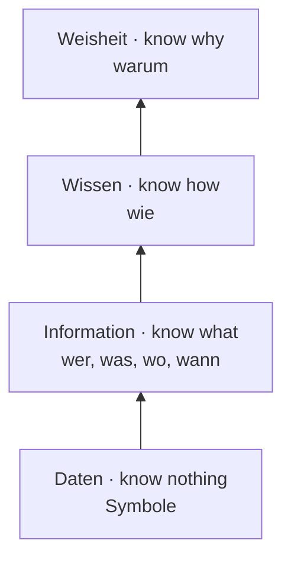
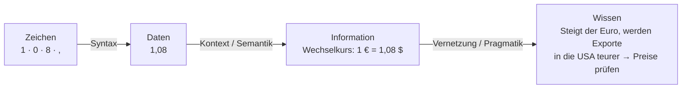

## Überblick

Mit diesem Modul beginnt **Kapitel 2: Informationsmanagement (IM)**. Der Begriff hat zwei Teile, **Information** und **Management**, und beide werden einzeln geklärt. Im Zentrum steht die Abgrenzung von **Daten, Information und Wissen** sowie die besonderen Eigenschaften von Information als Wirtschaftsgut.

> [!KLAUSUR]
> Sicher können musst du: **Daten, Information, Wissen jeweils mit Quelle definieren**, die **DIKW-Hierarchie**, das **Informationsparadoxon** und den Vergleich **materielle Güter vs. Informationen**.

## Warum Informationsmanagement?

Informationen sind eine **wichtige und knappe Ressource**, die sorgfältig geplant werden muss (Laudon/Laudon 2015). Sie dienen

- der **Vorbereitung von Entscheidungen** (z. B. Prognosen),
- als **Basis für Innovationen** (beruhen auf Vorwissen und Ideen),
- als **Kern des organisatorischen Wirtschaftens** (z. B. Koordination von Projekten).

→ Information ist für die betriebliche Leistungserstellung von **zentraler Bedeutung**.

## Die DIKW-Hierarchie

Die **DIKW-Hierarchie** (Data – Information – Knowledge – Wisdom; Rowley 2007, Chaffey & Wood 2005) ordnet die Begriffe in Stufen:

| Stufe | Label | Bedeutung | programmierbar? |
|---|---|---|---|
| **Weisheit** (Wisdom) | **know why** | Verstehen der Wahrheit: Was ist richtig, was falsch? | nein |
| **Wissen** | **know how** | Anwendung von Daten und Informationen; beantwortet **„wie“**-Fragen | nein |
| **Information** | **know what** | nützlich verarbeitete Daten; beantwortet **wer, was, wo, wann** | ja |
| **Daten** | **know nothing** | Symbole | ja |

> [!MERKE]
> Die unteren Stufen (Daten, Information) sind **algorithmisch/programmierbar**: Ein IS kann sie erzeugen. Die oberen (Wissen, Weisheit) sind **nicht programmierbar** und an den Menschen gebunden.

## Daten

> [!DEFINITION] Daten (DIN 44300)
> „Gebilde aus **Zeichen** oder kontinuierlichen Funktionen, die aufgrund bekannter oder unterstellter **Abmachungen** Informationen darstellen, vorrangig zum Zweck der Verarbeitung und als deren Ergebnis.“

> [!DEFINITION] Daten (ISO/IEC 2382-1)
> „A **reinterpretable representation** of information in a **formalized manner**, suitable for communication, interpretation, or processing.“ (wieder interpretierbare Darstellung von Information in formalisierter Art)

**Daten sind das Rohmaterial für Entscheidungen.** Aus operativen Transaktionsdaten lassen sich Kaufverhalten, Kundenwünsche, Markttrends, Qualität, Geschäftsentwicklung und Wettbewerber ableiten. Ganze **Geschäftsmodelle** beruhen darauf (Google, Facebook: Werbung auf Basis von Nutzerdaten, Daten-Deals mit Partnern).

### Datenchaos im Unternehmen

Viele Unternehmen haben einen gewachsenen **„Wildwuchs“** an Anwendungssystemen mit Dutzenden Schnittstellen. Symptome des **Datenchaos** (Jung 2003):

- Daten sind über diverse Datenbanken **verstreut**
- Daten sind **nicht vergleichbar** (Datumsformate, Währungen, Definitionen)
- es gibt **keinen zentralen Ort** für externe Zahlen (z. B. soziodemografische Daten)
- der **Zugriff** auf Datenbanken ist nur bedingt möglich
- geeignete Daten sind **schwer zu extrahieren**
- die Extraktion liegt bei wenigen **„Datenbänkern“** (SQL-Kennern)

> [!INFO] Funktionen eines Anwendungssystems (Laudon et al. 2016)
> **Eingabe → Verarbeitung → Ausgabe.** Analysefragen: Wie komplex ist jede Stufe, und wie häufig werden Daten eingegeben? Dieses Schema brauchst du für die UPS-Fallstudie in der Übung.

## Information

Von lat. *informare* = eine Gestalt geben.

| Perspektive | Definition | Quelle |
|---|---|---|
| allgemeinsprachlich | gegenwarts- und praxisbezogene Mitteilung über Dinge, die uns im Augenblick zu wissen wichtig sind | Seiffert 1971 |
| nachrichtenorientiert | diejenige **Unsicherheit**, die durch das Erscheinen eines Zeichens **beseitigt** wird | Gitt 1989 |
| **betriebswirtschaftlich** | **„Information ist zweckbezogenes Wissen.“** | **Wittmann 1959** |

> [!WARNUNG]
> Die Abgrenzung ist schwierig, weil die Zweckorientierung subjektiv ist. Information setzt Wissen voraus und ist zugleich Bestandteil von Wissen. In der Klausur **immer Wittmann** als BWL-Definition nennen.

**Information als vierter Produktionsfaktor:** Zimmermann (1972) erweitert die klassischen Faktoren **Arbeit, Boden, Kapital** um **Information**.

### Qualität von Informationen

- **Aussagegehalt:** Wahrscheinlichkeit, Prüfbarkeit, Genauigkeit, Vollständigkeit, relative Bedeutung, Objektivität, **Aktualität**, Wahrheitsgehalt
- **Darstellungsqualität:** Formatierung, Allgemeinverständlichkeit, Dokumentation, Anpassung an den Empfänger

### Besondere Eigenschaften von Informationsgütern

- **Immaterialität:** kein Gewicht, keine Lagerhallen, Übertragung mit Lichtgeschwindigkeit, globaler Marktplatz, **quasi beliebig kopierbar**, geringe Transportkosten
- **Informationsparadoxon** (siehe unten)
- **Erfahrungsgut:** Informationen kann man nicht „besichtigen“, Gut und Gutbeschreibung sind untrennbar

> [!DEFINITION] Informationsparadoxon
> **Vor** der Nutzung kann die Qualität einer Information nicht beurteilt werden; **nach** dem Konsum besteht **keine Zahlungsbereitschaft** mehr.

> [!DEFINITION] Erfahrungsgut
> Ein Gut, dessen Wert sich erst durch **Erfahren/Nutzen** einschätzen lässt. Konsumenten kaufen ungern, bevor sie wissen, was sie bekommen.

**Strategien gegen die Kaufzurückhaltung:**

| Strategie | Beispiel |
|---|---|
| **Content Browsing** | im Online-Buch blättern |
| **Previews** | Song-Vorschau, Trailer, erste Kapitel gratis |
| **Reviews und Ratings** | Sternebewertungen, Rezensionen |
| **Reputationsaufbau** | Markenname (z. B. renommierte Zeitung) |

### Materielle Güter vs. Informationen

| Materielle Güter | Informationen |
|---|---|
| hohe Vervielfältigungskosten | **niedrige** Vervielfältigungskosten |
| Wertverlust durch Gebrauch | **Wertgewinn durch Gebrauch** |
| Wertverlust durch Teilung | **Wertgewinn durch Teilung** |
| schwierige Verbreitung | **einfache** Verbreitung |
| Preisbildung bekannt | Preisbildung weitgehend **unbekannt** |

> [!BEISPIEL] Wertgewinn durch Teilung
> Ein Auto wird durch gemeinsame Nutzung abgenutzt und ist geteilt weniger wert. Eine Wissensdatenbank im Unternehmen wird dagegen wertvoller, je mehr Mitarbeitende sie nutzen und ergänzen.

## Wissen

> [!DEFINITION] Wissen (Probst/Raub/Romhardt 2012)
> Wissen bezeichnet die **Gesamtheit der Kenntnisse und Fähigkeiten**, die Individuen zur Lösung von Problemen einsetzen. Es umfasst theoretische Erkenntnisse und praktische Alltagsregeln. Wissen stützt sich auf Daten und Informationen, ist im Gegensatz zu diesen jedoch **immer an Personen gebunden**.

Information wird **sprachlich übermittelt**, Wissen bedarf **keiner Übermittlung**.

| Dimension | Ausprägungen |
|---|---|
| **implizit / explizit** | implizit = unbewusst, nicht formalisierbar (Fahrradfahren); explizit = speicherbar und weitergebbar (Handbuch) |
| **individuell / kollektiv** | Wissen einer Person bzw. einer Gruppe |
| **intern / extern** | im Unternehmen vorhanden bzw. von außen zu beschaffen |

### Zusammenhang: vom Zeichen zum Wissen

Daten, Information und Wissen bilden ein **Kontinuum**: Die Verdichtung ist ein schrittweiser **Entwicklungsprozess**, kein Sprung (Probst et al. 2012). Der **Anreicherungsprozess**:

> [!INFO]
> Das konkrete Beispiel im Diagramm (Wechselkurs) ist zur Veranschaulichung ergänzt. Prüfungsrelevant ist die Kette **Zeichen → (Syntax) → Daten → (Semantik) → Information → (Pragmatik) → Wissen**.

## Management

| Autor | Management ist … |
|---|---|
| **Ansoff 1966** | eine komplexe Aufgabe: **Analysen durchführen, Entscheidungen treffen, Bewertungen vornehmen, Kontrollen durchführen** |
| **Wild 1971** | die **Verarbeitung von Informationen** und ihre Verwendung zur **zielorientierten Steuerung von Menschen und Prozessen** |

Der Begriff ist mehrdeutig:

- **funktional:** das **Führen** eines Unternehmens (Tätigkeit)
- **institutionell:** die **Personengruppe**, die führt

Ausblick: In VL 05 werden beide Teile zum Begriff **Informationsmanagement** zusammengeführt.
